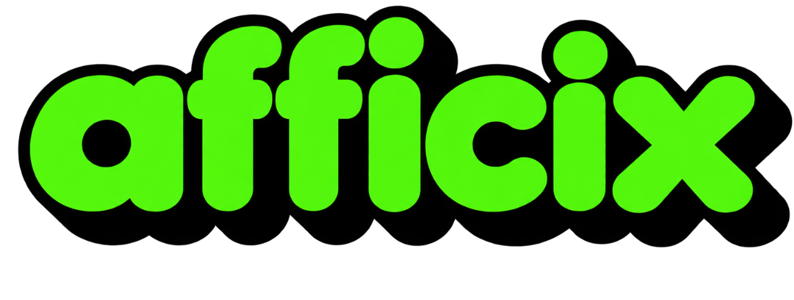

  

  <h1>Afficix</h1>

  
<strong>Connecting quality traffic with meaningful opportunity.</strong>

  

    A private CPC affiliate network experience for publishers and advertisers,
    built around discovery, clarity, and sustainable partnerships.
  

  

    <a href="https://afficix.com">Website</a>
    &nbsp;·&nbsp;
    <a href="mailto:contact@afficix.com">Contact</a>
  

---

## A network built around performance

Afficix brings publishers and advertisers together in a focused affiliate-network experience. Its public-facing story centers on campaign discovery, useful performance insight, and the relationships that help high-quality traffic find the right opportunities.

The product is designed to make that experience feel straightforward: a considered brand presence, a clear path to joining, and an account foundation shaped around manager-led oversight.

## A focused foundation

This repository contains the Afficix homepage and account-entry experience. The signed-in destination is intentionally kept minimal as the product takes shape.

  Thoughtfully connecting publishers, advertisers, and performance.

